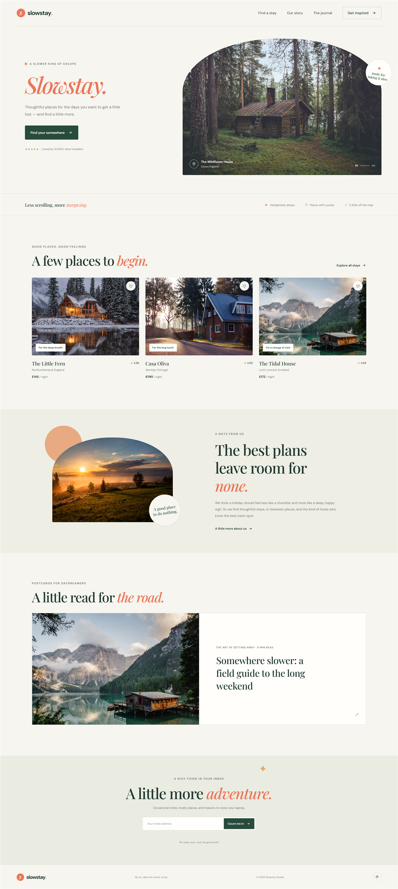

# Slowstay

Slowstay is a responsive landing page for a thoughtfully curated collection of slow-travel stays. Its calm editorial layout pairs destination photography and warm typography with small interactions that make finding a getaway feel simple.

## Full-page preview



## Project files

| File | Description |
| --- | --- |
| `index.html` | Page content, semantic sections, navigation, and newsletter form |
| `styles.css` | Visual design, responsive layouts, animation, and reduced-motion styles |
| `script.js` | Mobile navigation, stay save buttons, scroll reveals, and newsletter feedback |
| `screenshot.png` | Full-page desktop screenshot of the landing page |

## Getting started

The site uses plain HTML, CSS, and JavaScript. No build step, framework, or package installation is required.

1. Download or clone this project.
2. Open `index.html` in a modern browser.

To serve it locally instead, run a static file server from the project directory. For example, if Python is installed:

```bash
python -m http.server 8000
```

Then open [http://localhost:8000](http://localhost:8000).

## Page sections

- **Hero:** Brand introduction, primary call to action, social proof, and a featured stay.
- **Trust strip:** A quick introduction to the collection's handpicked stays.
- **Featured stays:** Three destination cards with locations, nightly prices, ratings, and save buttons.
- **Our story:** Editorial introduction to the slower-travel idea behind the collection.
- **Journal:** A featured travel-reading recommendation.
- **Newsletter:** An email-address field with an inline confirmation.
- **Footer:** Brand, copyright, and a back-to-top link.

## Interactions and accessibility

- The mobile navigation expands and collapses with an accessible state and label.
- Stay cards can be saved and unsaved using their heart buttons.
- Content reveals gently as it enters the viewport.
- The newsletter form validates the email field and displays an on-page confirmation. This is a front-end demonstration; it does not subscribe the visitor to a mailing list or send data to a server.
- Reduced-motion preferences, keyboard focus indicators, descriptive image text, and labeled form controls are supported.

## Design and external assets

The page uses a warm off-white background, forest-green text, and coral accents. The headings use Playfair Display, with DM Sans for supporting text. Google Fonts and the destination photographs are loaded from external services, so an internet connection is required to display those assets. If an external asset is unavailable, the rest of the page remains usable.

## Customization

- Update copy, links, prices, and destination details in `index.html`.
- Adjust colors, typography, spacing, breakpoints, and transitions in `styles.css`.
- Change navigation, save-button, scroll-reveal, or newsletter-demo behavior in `script.js`.
- Replace `screenshot.png` and its embedded preview above when capturing an updated page design.
